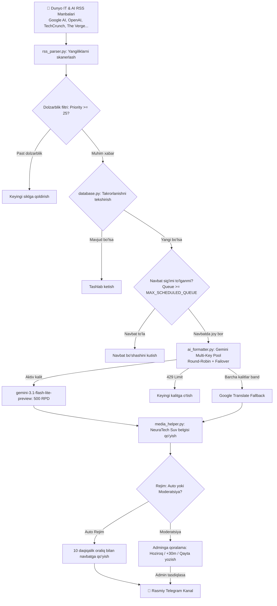

<div align="center">

# 🤖 NeuraTech AI — Telegram Avto-Post va Media Boti

**Dunyoning eng ilg‘or IT, Sun'iy Intellekt (AI), modellar, benchmarklar va apparat ta'minoti yangiliklarini Google Gemini AI Multi-Key hovuzi orqali saralab, professional o‘zbek tiliga o‘giruvchi, to‘liq avtomatlashtirilgan Telegram media platformasi.**

[](https://www.python.org/)
[](https://docs.aiogram.dev/)
[-8E75C2.svg?logo=google&logoColor=white)](https://aistudio.google.com/)
[](https://www.sqlite.org/)
[](https://www.docker.com/)
[]()
[]()

<p align="center">
  <a href="#-asosiy-va-yangi-imkoniyatlar">Asosiy Imkoniyatlar</a> •
  <a href="#-loyiha-arxitekturasi">Arxitektura</a> •
  <a href="#-admin-buyruqlari">Admin Buyruqlari</a> •
  <a href="#-tezkor-ornatish-va-ishga-tushirish">O‘rnatish</a> •
  <a href="#-docker-orqali-serverda-yurgizish">Docker Deployment</a> •
  <a href="#-sozlamalar-env-tavsifi">Sozlamalar (.env)</a>
</p>

---

</div>

## 🌟 Asosiy va Yangi Imkoniyatlar

### 🧠 1. Google Gemini Multi-Key Pool & Smart Failover
* **Ko'p kalitli hovuz (Multi-Key Pool)**: Bot bitta API kalitga bog'lanib qolmaydi. `.env` fayliga kiritilgan barcha kalitlar (`GEMINI_API_KEY`, `GEMINI_API_KEY_1`, `GEMINI_API_KEY_2`, ...) o'rtasida so'rovlar **Round-Robin** usulida teng taqsimlanadi.
* **Yuqori kvotali modellar**: Standart bepul 20 RPD chekloviga tushib qolmaslik uchun asosiy model sifatida kuniga **500 ta so'rov** taqdim etuvchi `gemini-3.1-flash-lite-preview` ishlatiladi.
* **Avtomatik sovutish (Smart Cooldown)**: Agar biron bir kalitda 429 (kvota tugashi) xatoligi yuz bersa, bot uni avtomatik 5 daqiqaga sovutish rejimiga oladi va darhol keyingi kalitga o'tadi.
* **Favqulodda Fallback**: Barcha AI kalitlari sovutishda bo'lsa ham xabarlar to'xtab qolmaydi — tizim avtomatik *Google Translate Fallback* orqali yangilikni uzluksiz tayyorlab boradi.

### ⚡️ 2. Aqlli Navbat va Anti-Burst Tizimi (Smart Queue)
* **10 daqiqalik xavfsiz oraliq (`POST_SPACING_MINUTES = 10`)**: Yangiliklar kanalga birdaniga to'kilib, obunachilarni bezovta qilmasligi uchun postlar avtomatik navbat bilan chiqariladi.
* **Navbat sig'imi nazorati (`MAX_SCHEDULED_QUEUE = 6`)**: Navbat to'lib, yangiliklar 6-8 soatga kechikib ketmasligi uchun navbat ko'pi bilan 6 ta post bilan cheklanadi.
* **Eskirgan xabarlarni tozalash (Stale Pruning)**: Rejalashtirilgan vaqti 2 soatdan ortiq o'tib ketgan yoki 4 soatdan keyinga surilib ketgan postlar avtomatik bekor qilinadi.
* **Tezkor tozalash buyruqlari**: Admin istalgan vaqtda `/queue` (yoki `/navbat`) hamda `/clear_queue` (yoki `/tozalash`) orqali to'planib qolgan navbatni 1 ta tugma bilan tozalay oladi.

### 📊 3. Zero-Token Tizim Diagnostikasi (`/status`)
* Bot holatini tekshirish mutlaqo **0 ta AI token** sarflaydi (avvalgi sun'iy test so'rovlari o'rniga operativ xotiradagi jonli holat ko'rsatiladi).
* **Diagnostika quyidagilarni o'z ichiga oladi**:
  * Bot Uptime (ish vaqti) va serverdagi aniq Toshkent vaqti;
  * Har bir Gemini kalitining holati (Aktiv, Sovutishda qolgan soniyalar, muvaffaqiyatli postlar soni);
  * Navbatdagi (Queue) va kanalda e'lon qilingan jami postlar soni;
  * Linux Docker operativ xotira (RAM) sarfi (cgroup v2), diskdagi bo'sh joy va SQLite baza hajmi.

### 🌙 4. Tungi Tinchlik Rejimi (Night Mode)
* Toshkent vaqti bilan **23:30 dan 07:30 gacha** kanalda tungi sukunat ta'minlanadi.
* Tunda kelgan sara yangiliklar yo'qolmaydi — ular ertalabki **08:00** dan boshlab navbat bilan e'lon qilishga rejalashtiriladi.

### 📰 5. Kechki Katta Dayjest (Daily Digest — 21:00)
* Har kuni kechki soat **21:00 da** o'sha kungi eng muhim 5 ta yangilik jamlanib, AI yordamida yagona dayjest postiga aylantiriladi va kanal logosiga biriktirilgan holda e'lon qilinadi.

### 💾 6. ACID Avto-Zaxiralash (Daily Backup — 03:00)
* Har kuni tungi **03:00 da** SQLite'ning tranzaksion `backup()` mexanizmi orqali baza to'xtovsiz holda xavfsiz ko'chiriladi, ZIP arxiv qilinadi va to'g'ridan-to'g'ri Adminga Telegram orqali yuboriladi.
* Admin panel orqali istalgan daqiqada bazani zaxiralab yuklab olish mumkin.

### 🎨 7. Zamonaviy Suv Belgisi (Glassmorphism Watermark)
* RSS manbalaridan yuklab olingan barcha rasmlarga `Pillow` orqali pastki o'ng burchakka estetik neon-ko'k hoshiyali, yarim shaffof qora shisha fonli va chaqmoq belgili **NeuraTech** brend belgisi qo'yiladi.

### 📢 8. 1:1 Reklama va Xabarnoma (Broadcast)
* Bot foydalanuvchilariga reklama yuborishda Telegram Premium emojilari, inline tugmalar va matn formatlari 100% o'z holicha saqlanadi (`copy_message`). Yuborishdan oldin admin uchun interaktiv **PREVIEW** taqdim etiladi.

### 🛡 9. Watchdog Fon Nazoratchisi
* Fondagi yangiliklar kuzatuvchi sikli (scheduler) kutilmagan tashqi xatoliklar tufayli to'xtab qolmasligi uchun `main.py` da avtomatik tiklovchi **Watchdog nazoratchisi** o'rnatilgan.

---

## 🏗 Loyiha Arxitekturasi



---

## 📋 Admin Buyruqlari

| Buyruq | Tavsif |
| :--- | :--- |
| `/admin` | Boshqaruv admin panelini ochish (Rejim, interval, statistika) |
| `/status` | **0 Token** tizim salomatligi: Uptime, Gemini kalitlari holati, RAM, DB hajmi |
| `/queue` yoki `/navbat` | Rejalashtirilgan postlar ro'yxatini ko'rish, tahrirlash yoki bekor qilish |
| `/clear_queue` yoki `/tozalash` | Eskirib qolgan barcha navbatdagi postlarni 1 ta bosishda tozalash |
| `/emojis` yoki `/emoji` | Telegram Premium animatsiyali emojilarini boshqarish paneli |
| `/feeds` | RSS manbalarini yoqish yoki o'chirish paneli |
| `/post <url>` | Istalgan veb-havolani 5 soniyada to'liq NeuraTech postiga aylantirish |
| `/help` | Barcha buyruqlar va qo'llanmani ko'rish |

---

## 🚀 Tezkor O‘rnatish va Ishga Tushirish

### 1. Repozitoriyni klonlash:
```bash
git clone https://github.com/your-username/telegram_bot_anons_ai.git
cd telegram_bot_anons_ai
```

### 2. Sozlamalarni kiritish (.env):
`.env.example` faylidan nusxa olib `.env` yarating va qiymatlarni to'ldiring:
```bash
cp .env.example .env
nano .env
```

### 3. Oddiy virtual muhitda ishga tushirish (Local):
```bash
# Virtual muhit yaratish
python3 -m venv venv
source venv/bin/activate  # Windows: .\venv\Scripts\activate

# Kutubxonalarni o'rnatish
pip install -r requirements.txt

# Botni ishga tushirish
python main.py
```

---

## 🐳 Docker Orqali Serverda Yurgizish (Tavsiya etiladi)

Loyiha to'liq Docker va Docker Compose asosida sozlangan bo'lib, serverda xotira, shriftlar va avto-qayta yuklanish (restart: always) bilan ta'minlangan.

### 1. Konteynerni qurish va orqa fonda ishga tushirish:
```bash
docker compose up -d --build
```

### 2. Jonli loglarni kuzatish:
```bash
docker logs -f neuratech-bot
```

### 3. Yangi o'zgarishlar kiritilganda serverni yangilash:
```bash
git pull origin main
docker compose up -d --build
```

### 4. Konteyner holatini tekshirish:
```bash
docker ps
```

---

## ⚙️ Sozlamalar (.env Tavsifi)

| Parametr | Standart | Majburiy | Tavsif |
| :--- | :---: | :---: | :--- |
| `BOT_TOKEN` | — | **Ha** | @BotFather bergan Telegram bot tokeni |
| `CHANNEL_ID` | — | **Ha** | Yangiliklar joylanadigan kanal ID raqami (`-100...`) |
| `CHANNEL_USERNAME` | — | **Ha** | Kanal username'i (masalan `@your_channel`) |
| `CHANNEL_LINK` | — | **Ha** | Kanalning to'liq havolasi |
| `BOT_USERNAME` | `your_bot` | Yo'q | Kanal postlari ostidagi tugmalar uchun bot username |
| `GEMINI_API_KEY` | — | **Ha** | Asosiy Google AI Studio API kaliti |
| `GEMINI_API_KEY_1`...`3` | — | Yo'q | Multi-Key hovuzi uchun qo'shimcha zaxira Gemini kalitlari |
| `ADMIN_ID` | — | **Ha** | Boshqaruvchi adminning Telegram ID raqami |
| `CHECK_INTERVAL_MINUTES`| `25` | Yo'q | Yangiliklarni skanerlash davriyligi (daqiqada) |
| `DEFAULT_MODE` | `auto` | Yo'q | Ish rejimi: `auto` (avtomatik) yoki `moderation` (adminga qoralama) |
| `POST_SPACING_MINUTES` | `10` | Yo'q | Postlar orasidagi minimal vaqt oralig'i (daqiqada) |
| `MAX_SCHEDULED_QUEUE` | `6` | Yo'q | Navbatda turishi mumkin bo'lgan maksimal postlar soni |
| `ENABLE_CHANNEL_SOURCE_BUTTON` | `True` | Yo'q | Post ostida asl maqolaga havola tugmasi |
| `ENABLE_CHANNEL_AI_BUTTON` | `True` | Yo'q | Post ostida bot AI maslahatchisiga o'tish tugmasi |
| `BACKUP_HOUR` | `3` | Yo'q | Har kungi avto-zaxiralash soati (Toshkent vaqti) |
| `EMOJI_*` | — | Yo'q | Telegram Premium animatsiyali Custom Emoji ID lari |

---

## 📂 Fayllar Tuzilishi

```text
├── .env                  # Maxfiy konfiguratsiyalar (Gitga yuklanmaydi)
├── .env.example          # Barcha parametrlar uchun to'liq konfiguratsiya namunasi
├── .gitignore            # Git istisnolari (.env, SQLite fayllari, logs)
├── README.md             # To'liq hujjatlashtirish va yo'riqnoma
├── Dockerfile            # Python 3.12-slim asosidagi Docker tasviri
├── docker-compose.yml    # Konteynerni boshqarish konfiguratsiyasi
├── requirements.txt      # Loyiha kutubxonalari (Aiogram, Google GenAI, Pillow...)
├── main.py               # Asosiy kirish nuqtasi va Watchdog nazoratchisi
├── config.py             # Global sozlamalar, manbalar va Premium Emoji xaritasi
├── database.py           # SQLite asinxron tranzaksion ma'lumotlar bazasi
├── scheduler.py          # Yangiliklar monitoring sikli, avto-navbat va kesh tozalash
├── ai_formatter.py       # Google Gemini Multi-Key Pool va o'zbekcha tarjima formateri
├── bot_handlers.py       # Admin panel, reklama (broadcast), navbat va foydalanuvchi menyusi
├── rss_parser.py         # Sara RSS manbalarini skanerlash va OpenGraph media yig'uvchi
├── media_helper.py       # Rasm/videolarni yuklash va dinamik suv belgisi (Watermark)
├── diagnostics.py        # 0-Token tizim monitoringi va admin ogohlantirish xizmati
├── backup_service.py     # SQLite ACID zaxiralash va ZIP arxiv yaratish moduli
└── neuratech_logo.jpg    # Kanalning rasmiy logotipi (Kechki dayjestlar uchun)
```

---

## 📄 Litsenziya

Loyiha ochiq kodli bo‘lib, **MIT** litsenziyasi ostida tarqatiladi.
