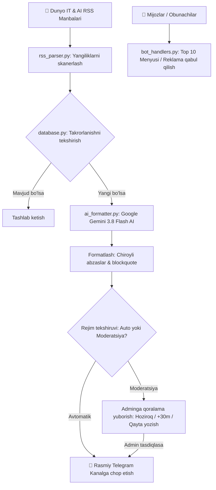

<div align="center">

# 🤖 AI & IT Telegram Avto-Post va Reklama Boti

**Eng ilg‘or IT, Sun'iy Intellekt (AI), modellar, benchmarklar va apparat ta'minoti yangiliklarini Google Gemini AI orqali professional o‘zbek tiliga o‘giruvchi, avtomatlashtirilgan Telegram media boti.**

[](https://www.python.org/)
[](https://docs.aiogram.dev/)
[](https://aistudio.google.com/)
[](https://www.sqlite.org/)
[]()
[]()

<p align="center">
  <a href="#-asosiy-xususiyatlar">Asosiy Xususiyatlar</a> •
  <a href="#-xabar-namunasi-preview">Xabar Namunasi</a> •
  <a href="#-loyixa-arxitekturasi">Arxitektura</a> •
  <a href="#-tezkor-ornatish">Tezkor O‘rnatish</a> •
  <a href="#-serverga-ornatish-vps--systemd">Serverda Ishlatish</a> •
  <a href="#-sozlamalar-env">Sozlamalar</a>
</p>

---

</div>

## 🌟 Asosiy Xususiyatlar

### 🧠 1. Google Gemini AI Tahlili
* Dunyoning eng sara texnologik manbalaridan (The Decoder, TechCrunch AI, The Verge, Tom's Hardware, Ars Technica) yangiliklarni avtomatik skanerlaydi.
* Murakkab texnik atamalar, benchmark natijalari va dasturlash modellarini tushunarli, aniq va jozibador o'zbek tiliga mahalliylashtiradi.
* `[...]` yoki chala gaplarni butunlay tozalaydi, grammatik yaxlitlikni saqlaydi.

### ⚡️ 2. Ikki Xil Nashr Rejimi (Dual Mode)
* 🟡 **Moderatsiya Rejimi (Tavsiya etiladi)**: Yangilik topilgach, avval Adminga shaxsiy botda keladi. Admin quyidagi interaktiv tugmalar orqali boshqaradi:
  * `🟢 🚀 Hoziroq kanalga chiqarish` — darhol kanalga chop etish;
  * `⏳ +30 daqiqa` / `⏳ +1 soat` — xabarni ma'lum vaqtga navbatga qo'yish;
  * `🔄 Qayta yozdirish (AI)` — Gemini orqali yanada ixcham qilib qayta yozdirish;
  * `🗑 Bekor qilish` — postni o'chirish.
* 🟢 **Avtomatik Rejim (Auto-Pilot)**: Postlar avtomatik navbat bilan (obunachilarni bezovta qilmaslik uchun 25 daqiqalik intervallar bilan) kanalga joylanadi.

### 📢 3. Mijozlarga 1:1 Reklama (Broadcast) Yuborish
* Botga kirgan har bir foydalanuvchi (`/start` yoki xabar yozgan) SQLite bazasiga ro'yxatga olinadi.
* Admin istalgan vaqtda **`🟢 📢 Reklama yuborish`** orqali ixtiyoriy xabar (matn, rasm, video, audio, havola yoki **Telegram Premium emojilari**) yuborishi mumkin.
* **100% Birga-bir nusxalash (`copy_message`)**: Barcha Telegram Premium emojilari va shriftlari 1:1 o'z holicha saqlanib barcha mijozlarga yetkaziladi.
* Yuborishdan oldin **PREVIEW** ko'rsatiladi va tasdiqlash so'raladi.

### 📱 4. Obunachilar uchun Interaktiv Portal (Top 10)
* Oddiy mijozlar botga kirganda:
  * `🟢 🔥 Top 10 ta AI Yangilik` — eng sara 10 ta xabar katalogi. Raqamli tugmalar (`[ 1 ]` ... `[ 10 ]`) orqali har bir yangilikni ochib o'qish mumkin.
  * `⚡️ Eng so'nggi yangilik` — kanaldagi oxirgi chiqarilgan yangilikni ko'rsatish.
  * `📢 Rasmiy Kanalimiz` — kanalga to'g'ridan-to'g'ri o'tish tugmasi.

### ✨ 5. Telegram Premium Custom Emoji Qo'llab-quvvatlashi
* `.env` faylida maxsus Premium Emoji ID lari ko'rsatilsa, bot xabarlardagi sarlavha va belgilarni `<tg-emoji>` ko'rinishida yuboradi.

### 🚨 6. Aqlli Diagnostika va Xatolik Tahlili
* Kanalga xabar chiqarishda muammo bo'lsa (masalan, bot kanalda admin emasligi yoki huquqi yetishmasligi), bot adminga darhol xatolikning **aniq sababi** va **yechish yo'riqnomasini** ko'rsatadi.

---

## 📱 Xabar Namunasi (Preview)

Bot tayyorlaydigan postlar Telegramda quyidagi mukammal tuzilishda chiqadi:

```html
⚡️ Meta o'zining ilk ilg'or "Muse Wonder" neyrotarmog'ini taqdim etdi

📌 Mohiyati:
Meta kompaniyasi murakkab hisob-kitoblar va dasturlashga ixtisoslashgan yangi avlod flagman modeli — Muse Wonder'ni rasman e'lon qildi...

<blockquote expandable>📊 Asosiy tafsilotlar:

• Ilgari chiqarilgan yengil hamda tezkor Muse Spark modelidan farqli o'laroq, yangi Wonder ancha yirik hajmga ega bo'lib, sintetik benchmark testlarida yuqori natijalarni qayd etmoqda.

• Mazkur model murakkab algoritmik masalalarni tahlil qilish, arxitektura tuzish va dasturlash kodlarini sifatli yozishda ishlab chiquvchilar uchun eng samarali vositaga aylanadi.

💡 Xulosa:
Meta o'zining ilk frontier modeli orqali bozordagi yetakchi gigantlar bilan to'g'ridan to'g'ri raqobatga kirishdi.

📡 Manba: The Decoder</blockquote>

🏷 #AI #Texnologiya #TheDecoder

🔔 Kanalimizga obuna bo‘ling: @grand_mobile_anons
```

---

## 🏗 Loyiha Arxitekturasi



---

## 🚀 Tezkor O‘rnatish

### 1. Repozitoriyni klonlash:
```bash
git clone https://github.com/SunnatDevPy/telegram_bot_anons_ai.git
cd telegram_bot_anons_ai
```

### 2. Virtual muhit yaratish va faollashtirish:
```bash
# Windows
python -m venv venv
.\venv\Scripts\activate

# Linux / macOS
python3 -m venv venv
source venv/bin/activate
```

### 3. Kutubxonalarni o‘rnatish:
```bash
pip install -r requirements.txt
```

### 4. Sozlamalarni kiritish (.env):
`.env.example` faylidan nusxa olib `.env` yarating:
```bash
# Windows
copy .env.example .env

# Linux / macOS
cp .env.example .env
```
Faylni ochib o'z ma'lumotlaringizni kiriting:
```env
BOT_TOKEN=1234567890:ABCDefghIJKLmnOPQRstuvwxyz
CHANNEL_ID=-1002229527376
CHANNEL_USERNAME=@grand_mobile_anons
CHANNEL_LINK=https://t.me/grand_mobile_anons
GEMINI_API_KEY=AQ.Ab8...Sizning_Google_Gemini_Kalitingiz
ADMIN_ID=5649321700
CHECK_INTERVAL_MINUTES=25
DEFAULT_MODE=moderation
```

### 5. Botni ishga tushirish:
```bash
python main.py
```

---

## 🖥 Serverga O‘rnatish (VPS / Linux)

Bot Long Polling orqali ishlagani sababli u hech qanday portni band qilmaydi va boshqa dasturlarga mutlaqo xalaqit bermaydi.

### 1-Variant: `systemd` orqali 24/7 ishlatish (Eng tavsiya etiladigani)
Serverda xizmat faylini yarating:
```bash
sudo nano /etc/systemd/system/telegram_bot_anons.service
```

Quyidagi konfiguratsiyani kiriting (yo'llarni serveringizga moslang):
```ini
[Unit]
Description=AI Telegram Anons Bot Service
After=network.target

[Service]
Type=simple
User=root
WorkingDirectory=/var/www/telegram_bot_anons_ai
ExecStart=/var/www/telegram_bot_anons_ai/venv/bin/python main.py
Restart=always
RestartSec=10

[Install]
WantedBy=multi-user.target
```

Xizmatni faollashtiring va yoqing:
```bash
sudo systemctl daemon-reload
sudo systemctl enable telegram_bot_anons
sudo systemctl start telegram_bot_anons
```

Holatini tekshirish:
```bash
sudo systemctl status telegram_bot_anons
```

### 2-Variant: `PM2` orqali ishlatish:
```bash
pm2 start main.py --name "ai_news_bot" --interpreter python3
pm2 save
pm2 startup
```

---

## ⚙️ Sozlamalar (.env Tavsifi)

| Parametr | Majburiy | Tavsif |
| :--- | :---: | :--- |
| `BOT_TOKEN` | Ha | @BotFather bergan Telegram bot tokeni |
| `CHANNEL_ID` | Ha | Yangiliklar joylanadigan kanal ID raqami (masalan `-100...`) |
| `CHANNEL_USERNAME` | Ha | Kanal username'i (masalan `@grand_mobile_anons`) |
| `CHANNEL_LINK` | Ha | Kanalning to'liq havolasi (`https://t.me/...`) |
| `GEMINI_API_KEY` | Ha | Google AI Studio dan bepul olingan API kalit |
| `ADMIN_ID` | Ha | Boshqaruvchi adminning shaxsiy Telegram ID raqami |
| `CHECK_INTERVAL_MINUTES` | Yo'q | Yangiliklarni tekshirish vaqti (standart: `25`) |
| `DEFAULT_MODE` | Yo'q | Boshlang'ich rejim: `moderation` yoki `auto` |
| `EMOJI_*` | Yo'q | Telegram Premium Custom Emoji ID raqamlari (ixtiyoriy) |

---

## 📂 Fayllar Tuzilishi

```text
├── .env                  # Maxfiy konfiguratsiyalar (Gitga yuklanmaydi)
├── .env.example          # Konfiguratsiya namunasi
├── .gitignore            # Git istisnolari (.env, SQLite bazalari)
├── README.md             # To'liq hujjatlashtirish
├── requirements.txt      # Kerakli Python kutubxonalari
├── main.py               # Asosiy ishga tushirish nuqtasi
├── config.py             # Sozlamalar va manbalar ro'yxati
├── database.py           # SQLite asinxron ma'lumotlar bazasi
├── rss_parser.py         # RSS xabarlari va OpenGraph rasmlarni yig'ish
├── ai_formatter.py       # Google Gemini 3.8 Flash bilan o'zbekcha formatlash
├── bot_handlers.py       # Admin panel, reklama (broadcast) va mijozlar menyusi
└── scheduler.py          # Yangiliklar sikli va avto-navbat boshqaruvi
```

---

## 👨‍💻 Muallif va Ruxsatnoma

Loyiha ochiq kodli bo‘lib, **MIT** litsenziyasi ostida tarqatiladi.  
Tuzuvchi: **[SunnatDevPy](https://github.com/SunnatDevPy)**

*Loyiha yoqqan bo‘lsa, GitHub'da ⭐ yulduzcha qo‘yishni unutmang!*
